# Meta API usage in TraceX

TraceX uses **Muse Spark for multilingual interpretation and evidence-driven investigation**. The model extracts reported facts, selects relevant installation or workshop records, drafts source-cited claims, and revises the investigation when new information arrives. These outputs feed the product's stored investigation and review workflow.

This guide maps that contribution to implementation and recorded evidence. The rubric recorded in [HACKATHON.md](../HACKATHON.md#event-contributions-and-reused-work) allocates **25% to Use of Meta AI Tooling**. [ELIGIBLE_WORK.md](../ELIGIBLE_WORK.md) distinguishes the reused application and adapter from the investigation, integration, validation and evaluation work added during the event.

## Start with the recorded evidence

| Evidence | Recorded scope | What a judge can inspect |
|---|---|---|
| [Direct Meta Hindi intake](../reports/hackathon/meta_live_smoke.json) · 28 October | `api.meta.ai`, `muse-spark-1.3`, real transport on a fictional complaint | Original Hindi report, accepted English normalization and sentiment proposal, AI event, resulting case and successful 37-action ledger check |
| [Campaign symptom extraction](../reports/hackathon/safety_campaign_smoke.json) · 29 October | Baseten-hosted `meta-models/muse-spark-open-1026`, fictional Hinglish report | `clunk` and `steering_pull` suggestions attached to the original quotation, with `review_required: true` |
| [First sourced investigation](../reports/hackathon/investigation_live_smoke.json) and [missing-record follow-up](../reports/hackathon/investigation_followup_smoke.json) · 29 October | Four completed runs; **eight logical model calls** | Model-selected `installed_part`, `workshop_history` and `owner_history` lookups, linked drafts, original source IDs and quotations |
| [Stored-report investigation proof](../reports/hackathon/investigation_current_live_smoke.json) · 30 October | Two completed runs; **four real HTTP attempts**, all returned 200 and passed schema validation | Model/host, request/prompt/schema hashes, token usage, selected lookup, revised brief and a withheld observation whose citation omitted a year |
| [Classification manifest](../reports/defect/repair/classification_manifest.json) · 29 October | **2,498 complaint records and 77 recall-reference records** with saved schema-valid Muse Spark Open labels | Model ID, `defect-cls-v2` prompt version, taxonomy/system-prompt hashes and hashes of the published prediction files |
| [Development comparison](../reports/defect/evidence_v1/development_comparison.json) · 29 October | **Eight valid model extraction outputs**, with four label agreements against the lightweight student | Saved predictions and versioned comparison; agreement is measured, human accuracy is unavailable |

The three investigation proof files contain **six distinct runs and twelve logical model calls** in total. Only the 30 October proof includes the newer per-HTTP-attempt instrumentation. Its `budget_after.live_successful_requests` also records a historical snapshot of **430 successful requests through this client**. That cumulative counter is neither a current account total nor another disjoint experiment; do not add it to the other counts.

Classification counts are **records**, not HTTP requests: batching and caching can process multiple records per call, and earlier manifests overlap this repaired export. These saved results do not establish live-service reliability or correctness on future inputs.

## How Muse Spark changes the investigation

```mermaid
flowchart LR
    A[Stored owner report] --> B[Server-owned redacted sentences]
    B --> C[Muse Spark: extract facts and choose lookups]
    C --> D[Server: read selected vehicle records]
    D --> E[Muse Spark: cited brief and next information need]
    E --> F[Schema and citation checks]
    F --> G[Inspect and review the draft]
    G --> H[Linked revision and evidence export]
```



1. **Understand the report.** [complaint_evidence.py](../src/ai_layer/complaint_evidence.py) asks Muse Spark to extract vehicle, part, symptom, failure mode, timing, negation and uncertainty from English, Hindi or Hinglish. Every observation identifies a supplied source sentence. Missing information stays unknown; a symptom alone cannot establish a mechanical cause.
2. **Choose useful evidence.** The response chooses up to two lookups from `installed_part`, `workshop_history` and `owner_history`. The server dispatches these validated choices against the selected campaign and vehicle. The model returns a structured `lookups` field in its chat response; the application executes the read-only tools.
3. **Compare the evidence.** [campaign_investigator.py](../src/ai_layer/campaign_investigator.py) makes the second logical model call. Muse Spark drafts claims marked `supports`, `contradicts` or `unresolved`, supplies their sentence IDs, and selects the next information need. The application renders the corresponding bounded follow-up question.
4. **Revisit changed records.** A follow-up links to its parent, carries recorded corrections, rechecks stored source references and performs current lookups. Earlier claims are historical context. The 30 October proof shows an initially unknown installation relationship followed by a brief citing the newly attached fictional installation record.
5. **Keep each point inspectable.** The server attaches original quotations, rejects unknown citations and applies targeted checks for unsupported identifiers, numbers and selected denial reversals. The same proof preserves one withheld observation alongside the accepted brief. Each displayed interpretation has Accept, Correct or Reject controls; citation fidelity does not prove semantic correctness.

Each investigation turn uses at most **two logical model calls**, with up to **three turns** supported. HTTP retries are separately bounded and recorded. Drafting an investigation does not modify campaign approval or clear a vehicle. The UI consumes stored drafts in [CampaignInvestigation.jsx](../dashboard/src/ai/CampaignInvestigation.jsx); [sourced-investigation.md](sourced-investigation.md) describes the complete handoff and review flow.

## Models and API routes

All provider requests use [meta_client.py](../src/ai_layer/meta_client.py), with model/backend selection in [config.py](../src/ai_layer/config.py).

| Provider and model | API route | Implemented role | Evidence status |
|---|---|---|---|
| Direct Meta · `muse-spark-1.3` | `https://api.meta.ai/v1/chat/completions` | Structured text interpretation and optional image-content analysis | Live text intake recorded; vision remains unverified |
| Baseten · `meta-models/muse-spark-open-1026` | `https://inference.baseten.co/v1/chat/completions` | Muse Spark Open symptom extraction, sourced investigation and historical classification | Recorded product calls and saved classification artifacts |
| Direct Meta · `sam-3.1` | `{META_API_BASE}/responses` | Parse segmentation output into region boxes for photo overlays | Implementation and smoke harness present; no published successful live proof |
| Direct Meta · `muse-image-1.0` | `{META_API_BASE}/images/generations` | Optional synthetic demo-image generation | Demo tooling only; no published successful live proof |

Direct Meta and Baseten transports are identified separately in the evidence. `META_BACKEND=meta` or `META_BACKEND=baseten` pins the provider; `auto` selects the configured provider. Baseten's chat backend does not support the SAM Responses or image-generation paths. `META_API_KEY` / `MODEL_API_KEY` and `BASETEN_API_KEY` remain server-side credentials.

## Other product call sites

| Call site | Meta contribution | Scope |
|---|---|---|
| [intake_enhancer.py](../src/ai_layer/intake_enhancer.py), [normalize.py](../src/ai_layer/normalize.py) | Propose missing intake facts and normalize Hindi/Hinglish while retaining original text | Existing slot/identity validation decides acceptance; the Hindi proof demonstrates accepted normalization |
| [severity.py](../src/ai_layer/severity.py) | Propose severity and sentiment from the report | AI may raise the deterministic floor; it cannot lower a rule-triggered safety response |
| [safety_campaigns.py](../src/ai_layer/safety_campaigns.py) | Extract symptom suggestions from owner replies with source quotations | Recorded Hinglish extraction; suggestions remain reviewable |
| [grounded_brief.py](../src/ai_layer/grounded_brief.py), [vehicle_risk.py](../src/ai_layer/vehicle_risk.py) | Add constrained explanation to investigation/risk context | Optional paths; no separate successful live proof for every caller or model-derived calibrated risk is claimed |
| [evidence.py](../src/ai_layer/evidence.py) | Image interpretation and SAM region-box handling | Optional media integrations; live verification is pending |
| [defect_classify.py](../scripts/defect_classify.py) | Batch historical narratives into a fixed defect taxonomy | Model/prompt/taxonomy cache keys, schema validation, saved outputs and explicit `other_unclear` labels |
| [meta_narrate](../src/ai_layer/meta_client.py), [ai_demo_seed.py](../scripts/ai_demo_seed.py) | Optional text narration and synthetic demo-image tooling | Narration here generates text, not speech; image generation is a demo-tool path |

The original adapter, frontline orchestration, deterministic safety layer and parts of the AI enhancement layer were reused. Their role is disclosed in [ELIGIBLE_WORK.md](../ELIGIBLE_WORK.md); `de3c483946..HEAD` identifies the subsequent event contributions.

## Historical model evaluation

The [published predictions](../reports/defect/repair/classifications.parquet) make the Muse Spark Open classifier inspectable without another API call. The [Round 4 result](../reports/improvement/human_reviews/round4/review_status.json) reports **246/300 = 82.0% accuracy, macro-F1 0.514** against that historical adjudicated sample. The grounded challenger scored **238/300 = 79.3%** against Round 4 gold and was rejected; six missing predictions remained in the denominator. The [claim index](../reports/hackathon/CLAIM_INDEX.md) identifies both gold versions and their results.

The separate [fuel holdout](../reports/defect/fuel_holdout/README.md) uses historical Meta-generated labels to train a local lightweight student. Its selected policy matched **5/8 campaigns**, equalling the count baseline. That replay makes no new model calls and provides no demonstrated predictive improvement. MiniLM is a separate local embedding model and is not Meta tooling.

These scoped historical results do not measure investigator time saved, accident prevention or semantic correctness of every live investigation. Review provenance, sample limits and withdrawn review claims remain inspectable in the claim index.

## Execution controls and observability

- **Validate returned data.** `chat_json` locally checks the output schema. Direct Meta receives `json_schema`; the Baseten compatibility path can use `json_object` and still requires local validation. A schema-valid response must also pass the caller's checks.
- **Trace the operation.** [operation_trace.py](../src/ai_layer/operation_trace.py) records attempt/model/host identifiers, timestamps, request/prompt/schema hashes, token usage, validation and fallback. [call_health.py](../src/ai_layer/call_health.py) exposes call-type success/failure and latency through `/api/ai/call-health`. Each stored investigation carries its own execution mode and timestamp; a configured AI badge alone is not live proof.
- **Bound execution.** Timeouts, retries, a cross-process daily call cap, provider-host checks and the [reservation ledger](../src/ai_layer/budget.py) constrain calls. The default lifetime reservation allowance is $30 and is configurable; token-cost estimates and reservations are not provider invoices.
- **Preserve source control.** Personal information is redacted before model input. Tools access selected-vehicle read-only records. An interrupted request retains its state and spend; refreshing or retrying that request ID does not silently repeat inference.
- **Expose fallback.** Without an enabled provider, no model call is made. Source records and manual/deterministic handling remain available. Failures and withheld interpretations are retained rather than counted as successful conclusions.

## Verify and demonstrate it

From an installed checkout, validate published artifacts without keys, network access or model spend:

```bash
python3 -m scripts.public_replay
```

This checks indexed saved hashes, arithmetic and quotation fidelity. It does not rerun inference or fully reproduce historical training. Full-data requirements are linked from the [claim index](../reports/hackathon/CLAIM_INDEX.md#full-data-replay).

For a new synthetic live text check with your own configured provider and credits:

```bash
python3 -m scripts.ai_meta_smoke
```

That command makes provider requests and writes a new smoke artifact; preserve existing proof before rerunning it. Optional `--vision --sam --image` switches attempt the media paths separately. Use [judge_setup.sh](../scripts/judge_setup.sh) and [HACKATHON.md](../HACKATHON.md#run-the-judge-demo) for the installed product workflow.

For the three-minute demonstration, show one continuous sequence: original multilingual report → Muse Spark observations and selected lookup → missing installation record → linked revised brief with exact citations → review and evidence export. Show the run's provider/model and execution mode. `run_lotguard_demo.py --offline` makes zero provider calls; saved proof retains its original date and synthetic label. The recorded live examples use fictional typed reports and scripted reviews, so they do not establish microphone performance or participant outcomes.

**Suggested submission wording:** “TraceX uses Muse Spark to interpret multilingual automotive reports, choose bounded evidence lookups, and produce source-cited investigation drafts that update when new records arrive. We publish direct Meta and Baseten-hosted Muse Spark Open integration evidence, per-operation traces, and versioned historical classification outputs. Model interpretations, failed attempts and validation limits remain inspectable.”

Muse Spark does not transcribe audio in this implementation. Browser Web Speech or optional Deepgram handles recognition. WhatsApp is a mock intake, raw-video model analysis is disabled, and Muse Wonder, Modal and Fireworks have no verified implementation evidence in this submission. SAM/vision/image paths remain separate from the verified text contribution.
